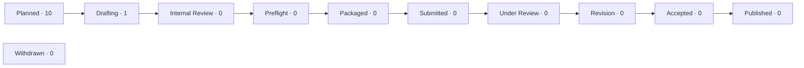

# Odyssey Manuscript Tracker

> Visual status for the Odyssey manuscript program. This file is generated from
> each manuscript's `status.json`; update the status record, not this page.

**Data as of:** 2026-10-19 · **Manuscripts:** 11 · **Drafting:** 1 · **Planned:** 10 · **Published:** 0

## Snapshot

| Stage | Count | Share |
| --- | ---: | ---: |
| ⚪ Planned | 10 | `██████████████████░░` 91% |
| ✍️ Drafting | 1 | `██░░░░░░░░░░░░░░░░░░` 9% |
| 🔎 Internal Review | 0 | `░░░░░░░░░░░░░░░░░░░░` 0% |
| 🧪 Preflight | 0 | `░░░░░░░░░░░░░░░░░░░░` 0% |
| 📦 Packaged | 0 | `░░░░░░░░░░░░░░░░░░░░` 0% |
| 📨 Submitted | 0 | `░░░░░░░░░░░░░░░░░░░░` 0% |
| 👀 Under Review | 0 | `░░░░░░░░░░░░░░░░░░░░` 0% |
| 🔁 Revision | 0 | `░░░░░░░░░░░░░░░░░░░░` 0% |
| ✅ Accepted | 0 | `░░░░░░░░░░░░░░░░░░░░` 0% |
| 🎉 Published | 0 | `░░░░░░░░░░░░░░░░░░░░` 0% |
| ⛔ Withdrawn | 0 | `░░░░░░░░░░░░░░░░░░░░` 0% |

## Pipeline



## Active work

- [Small Is Beautiful: Capable AI for Hospitals That Will Never Have a GPU Farm](./viewpoint-nature-medicine/) — Nature Medicine · ✍️ Drafting · updated 2026-10-19

## All manuscripts

| Manuscript | Target journal | Stage | Lifecycle position | Updated |
| --- | --- | --- | --- | --- |
| [Small Is Beautiful: Capable AI for Hospitals That Will Never Have a GPU Farm](./viewpoint-nature-medicine/)<br><sub>viewpoint-nature-medicine</sub> | Nature Medicine | ✍️ Drafting | `█░░░░░░░░░` 11% | 2026-10-19 |
| [Twelve Tips for Using Local Small Language Models as Study Companions in Medical Training](./ai-tutors-med-ed/)<br><sub>ai-tutors-med-ed</sub> | Medical Teacher | ⚪ Planned | `░░░░░░░░░░` 0% | 2026-10-19 |
| [Artificial Intelligence Without Infrastructure: A Deployment Model for Low-Resource Health Facilities](./ai-without-infrastructure/)<br><sub>ai-without-infrastructure</sub> | Bulletin of the World Health Organization | ⚪ Planned | `░░░░░░░░░░` 0% | 2026-10-19 |
| [Production per Dollar: A Cost-Effectiveness Analysis of Small-Model Teams Versus Large Models for Clinical Text Processing](./compute-value-accounting/)<br><sub>compute-value-accounting</sub> | Value in Health | ⚪ Planned | `░░░░░░░░░░` 0% | 2026-10-19 |
| [Collaborative Small Language Models for Clinical Text Tasks Under Resource Constraints: A Comparative Evaluation Against a Single Large Model](./kintsugi-clinical-battery/)<br><sub>kintsugi-clinical-battery</sub> | JAMIA | ⚪ Planned | `░░░░░░░░░░` 0% | 2026-10-19 |
| [A Goal-State Protocol with Verified Uptake for Clinical AI Pipelines: Design and Validation](./kintsugi-protocol/)<br><sub>kintsugi-protocol</sub> | Artificial Intelligence in Medicine | ⚪ Planned | `░░░░░░░░░░` 0% | 2026-10-19 |
| [Implementing Local-First Artificial Intelligence in a Resource-Limited Institution: Workflow, Governance, and Lessons Learned](./local-ai-implementation/)<br><sub>local-ai-implementation</sub> | International Journal of Medical Informatics | ⚪ Planned | `░░░░░░░░░░` 0% | 2026-10-19 |
| [Local Small-Model Teams for Orthopaedic Evidence Synthesis: Deduplication, Screening, and Structured Extraction Without Cloud Infrastructure](./ortho-evidence-synthesis/)<br><sub>ortho-evidence-synthesis</sub> | Clinical Orthopaedics and Related Research | ⚪ Planned | `░░░░░░░░░░` 0% | 2026-10-19 |
| [A Time-Out at Every Handoff: The PRIMUM Protocol for Harm Avoidance in Multi-Agent Artificial Intelligence Workflows](./primum-protocol/)<br><sub>primum-protocol</sub> | NEJM AI | ⚪ Planned | `░░░░░░░░░░` 0% | 2026-10-19 |
| [Local Small Language Models as Study and Feedback Tools in Residency Training: A Feasibility Report](./resident-local-models/)<br><sub>resident-local-models</sub> | Journal of Graduate Medical Education | ⚪ Planned | `░░░░░░░░░░` 0% | 2026-10-19 |
| [Adversarial Evaluation of Small Clinical Language Models: Failure Classes and Team-Based Mitigations](./small-model-redteam/)<br><sub>small-model-redteam</sub> | BMJ Quality & Safety | ⚪ Planned | `░░░░░░░░░░` 0% | 2026-10-19 |

## Updating this tracker

1. Change the stage through the manuscript CLI, which updates `status.json`.
2. Regenerate the machine-readable rollup and this visual tracker:

```bash
python3 manuscripts/tools/manuscripts.py rollup --root manuscripts
python3 manuscripts/tools/manuscripts.py tracker --root manuscripts
```

Machine-readable data: [rollup.json](./rollup.json).
